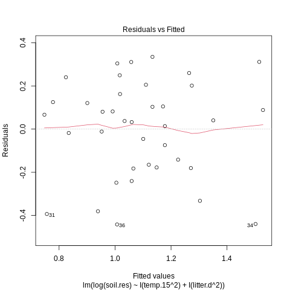
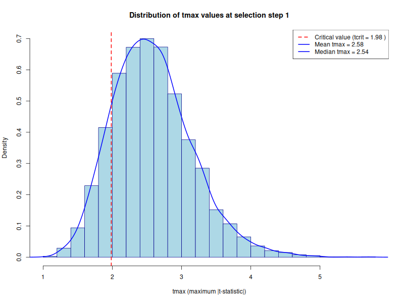

# Soil respiration modelling: regression, model selection and a simulation study (R)

Statistical analysis of soil CO₂ efflux (soil respiration) measured in **Hainich National Park, Germany**.
The project builds a small, interpretable prediction model from 32 environmental predictors with only
**38 observations**, and uses a **simulation study** to show why naive t-tests during forward selection
inflate the false-positive rate.

> University project (M.Sc. Bioinformatics, FSU Jena, module *Statistical Methods*, group of 4, grade 1.3).
> Report (German): [`latex/Script.pdf`](latex/Script.pdf)

## Question
Which soil and litter variables best explain soil respiration, and how reliable is stepwise
predictor selection when many candidate predictors are tested?

## Data
`hainich.csv`: 38 measurements of soil respiration (`soil.res`) plus soil temperature at four depths,
soil and litter moisture, litter depth, pH, root biomass, C/N content, nitrate, ammonium and DOC.
Data provided by A. Soe (Max Planck Institute for Biogeochemistry) for teaching purposes.

## Methods
- Log-transformation of the right-skewed target
- Correlation and multicollinearity analysis
- Four biologically motivated candidate linear models (incl. quadratic terms and interactions)
- Model selection by **BIC**, validated with **LOOCV** and **k-fold cross-validation**
- Assumption checks: **Shapiro-Wilk** (normality), **Breusch-Pagan** (heteroscedasticity), **Cook's distance**
- **Simulation study (5,000 runs):** forward selection over 64 candidate terms, recording the maximum
  t-statistic per step to estimate the real type-I error

## Results
**Final model:** `log(soil.res) ~ temp.15² + litter.d²` (soil temperature at 15 cm + litter depth)

| Model | Adj. R² | BIC | LOOCV RMSE | k-fold RMSE | Shapiro p | Breusch-Pagan p |
|---|---|---|---|---|---|---|
| **lm1 (final)** | 0.400 | **7.50** | **0.245** | **0.250** | 0.080 | 0.513 |
| lm2 | 0.295 | 13.63 | 0.255 | 0.255 | 0.278 | 0.699 |
| lm3 | 0.136 | 21.34 | 0.307 | 0.307 | 0.844 | 0.733 |
| lm4 | 0.436 | 10.21 | 0.254 | 0.258 | 0.512 | 0.217 |

The most parsimonious model wins: with 38 data points, additional predictors and interactions did not
improve BIC or cross-validated error. All model assumptions hold.



**Simulation:** although the data-generating model contains only **2** predictors, naive forward
selection with t-tests at α = 0.05 added up to **7**. The empirical error rate was **85 %** in the first
selection step and 53 % in the second, far above the nominal 5 %. Corrections such as Bonferroni or a
simulated max-t threshold are needed.



## Repository structure
```
abgabe_code/       final R scripts (model selection, interactions, simulation, helpers)
latex/             report source and compiled PDF (German)
hainich.csv        dataset
*.ipynb            exploratory notebooks
```

## How to run
```r
install.packages(c("boot", "lmtest", "zoo", "leaps"))
setwd("abgabe_code")
source("model_selection.r")          # candidate models, BIC, diagnostics
source("interaktion_finales_modell.r")  # interactions & final model
source("simulation.r")               # simulation study (takes a few minutes)
```

## Tech
R · linear models · BIC · cross-validation · residual diagnostics · Monte-Carlo simulation · LaTeX
